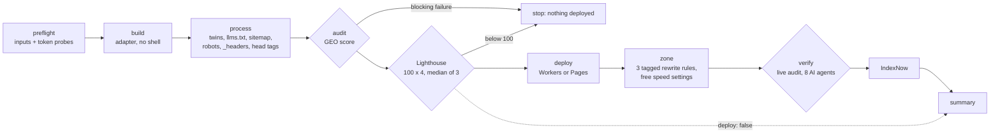

<p align="center">
  <a href="https://geo.avarok.net">
    <picture>
      <source media="(prefers-color-scheme: dark)" srcset="brand/wordmark-dark.svg">
      
    </picture>
  </a>
</p>

<p align="center">
  <a href="https://github.com/Avarok-Cybersecurity/geoharness/actions/workflows/core.yml"></a>
  <a href="https://github.com/Avarok-Cybersecurity/geoharness/actions/workflows/host.yml"></a>
  <a href="https://github.com/Avarok-Cybersecurity/geoharness/actions/workflows/dist.yml"></a>
  <a href="https://github.com/Avarok-Cybersecurity/geoharness/actions/workflows/deploy.yml"></a>
  <a href="#license"></a>
</p>

**GeoHarness** is a GitHub Action that makes any website agent-ready on Cloudflare's free plan. It builds your site, gives every page a markdown twin that AI agents receive when they send `Accept: text/markdown` (what Cloudflare's Markdown for Agents does on Pro and above), writes `llms.txt`, a sitemap and a robots.txt with Content Signals, gates the build on an evidence-graded GEO score and Lighthouse 100, deploys to Cloudflare Workers or Pages, and verifies the live site with real AI user agents. Its own site, [geo.avarok.net](https://geo.avarok.net), is built and deployed by this repository's action.

## Contents

- [Quick start](#quick-start)
- [How it works](#how-it-works)
- [Inputs and outputs](#inputs-and-outputs)
- [geoharness.toml](#geoharnesstoml)
- [Adapters and runtime detection](#adapters-and-runtime-detection)
- [Cloudflare setup and permissions](#cloudflare-setup-and-permissions)
- [Free-tier limits](#free-tier-limits)
- [GEO score](#geo-score)
- [Lighthouse gate](#lighthouse-gate)
- [AI search with LatticeDB](#ai-search-with-latticedb)
- [Security model](#security-model)
- [FAQ](#faq)
- [Contributing](#contributing)
- [License](#license)
- [Citations](#citations)

## Quick start

1. Create a Cloudflare API token with the [permission groups below](#cloudflare-setup-and-permissions) and add the repository secrets `CLOUDFLARE_API_TOKEN` and `CLOUDFLARE_ACCOUNT_ID`.
2. Add `geoharness.toml` to your site directory:

```toml
[site]
origin = "https://www.example.com"
name = "Example"
language = "en"

[identity]
kind = "organization"
name = "Example Inc"
url = "https://www.example.com/"

[contentSignal]
search = true
aiInput = true
aiTrain = false

[[bots]]
group = "search"
tokens = ["OAI-SearchBot", "Claude-SearchBot", "PerplexityBot"]
allow = ["/"]

[content]
mainSelector = "main"

[llms]
summary = "Example makes examples."
sections = []
```

3. Add the workflow:

```yaml
name: deploy
on:
  push:
    branches: [main]
  pull_request:
jobs:
  site:
    runs-on: ubuntu-latest
    steps:
      - uses: actions/checkout@v7
      - uses: Avarok-Cybersecurity/geoharness@v1
        with:
          cloudflare-api-token: ${{ secrets.CLOUDFLARE_API_TOKEN }}
          cloudflare-account-id: ${{ secrets.CLOUDFLARE_ACCOUNT_ID }}
          site-path: site
          project-name: my-site
          domains: www.example.com
          geo-min-score: 80
          lighthouse-max-urls: 5
          # Pull requests build, audit and run Lighthouse without deploying or touching the zone.
          deploy: ${{ github.event_name == 'push' }}
          # Required when deploying: put the previous version back if the live checks fail.
          rollback-on-failure: true
```

## How it works

A pure Rust core, compiled to WebAssembly, makes every decision; a TypeScript host performs every I/O and asks the core what to do ([contract](docs/architecture/contract.md)).



Requests whose `Accept` header contains `text/markdown` are rewritten by a free URL Rewrite rule to the page's twin (`/docs/` → `/docs/index.md`); everything else gets the HTML. Responses carry `Vary: Accept`.

## Inputs and outputs

Composite actions do not enforce `required`, so GeoHarness validates every input in preflight and lists every problem at once.

<!-- generated:inputs -->
### Inputs

| Input | Required | Default | Description |
|---|---|---|---|
| `cloudflare-api-token` | no | — | Cloudflare API token. Permission groups per feature are listed in cloudflare-permissions.json. Required when deploy is true. |
| `cloudflare-account-id` | no | — | Cloudflare account ID (32 hex characters). Required when deploy is true. |
| `site-path` | yes | — | Directory of the site inside the repository; it must contain geoharness.toml. |
| `adapter` | no | `auto` | Build adapter: auto (detect), static, command, npm, sveltekit-static, python, make, vite-prerender, worker-assets. |
| `build-command` | no | — | Build command, run without a shell (quotes group words; pipes, redirects, ; & $ are rejected — use a script). |
| `output-dir` | no | — | Build output directory relative to site-path. Required by static, command, python and make. |
| `target` | no | `workers` | Deploy target: workers (assets-only Worker on Custom Domains) or pages. |
| `project-name` | yes | — | Worker or Pages project name (lower-case letters, digits, hyphens). |
| `domains` | yes | — | Newline-separated host names to serve the site on. The host of site.origin in geoharness.toml must be one of them. |
| `lighthouse` | no | `true` | Run the Lighthouse gates (100 in all four categories, median of 3 runs): before deploy against the output served locally by wrangler with the deploy's own config, and after deploy against the live site. false skips both. |
| `lighthouse-max-urls` | no | — | How many URLs from the generated sitemap Lighthouse audits, locally and live. Required when lighthouse is true. |
| `geo-min-score` | yes | — | Minimum GEO score (0–100) for the build audit and the live audit. |
| `extra-optimizations` | no | `all` | Free zone optimizations, as tokens applied left to right: all, none, &lt;id>, -&lt;id>. Ids: email_obfuscation, rocket_loader, early_hints, http3, brotli, smart_tiered_cache, zstd, bot_fight_mode, ai_bots_protection. Example: "all -rocket_loader". |
| `deploy` | no | `true` | true deploys, configures the zone, verifies live and pings IndexNow. false is a dry run for pull requests: build, process, GEO audit and Lighthouse only, with no Cloudflare API call. |
| `rollback-on-failure` | no | — | Required when deploy is true (no default). true: when the post-deploy verification (live GEO audit or the production Lighthouse gate) fails or cannot complete, put production back on the version it served before this deploy (wrangler rollback for workers, the Pages rollback API for pages), then fail. false: fail and leave the new build live. A first deploy has nothing to roll back to and just fails. |
| `rag` | no | `false` | Coming in v1.1 (RAG index export). Not implemented yet; setting it to true fails the run. |

### Outputs

| Output | Description |
|---|---|
| `geo-score` | GEO score of the live site (the build audit's when the run stopped before verify). |
| `url` | The deployed URL. |
| `markdown-count` | Number of markdown twins generated. |
<!-- /generated:inputs -->

## geoharness.toml

The full reference is in [docs/config.md](docs/config.md) and on [geo.avarok.net/docs/config/](https://geo.avarok.net/docs/config/). In short:

- `[site]` origin, name and language; `[identity]` the person or organization behind the site, with `sameAs` profiles.
- `[contentSignal]` `search`, `aiInput`, `aiTrain`: required, never defaulted; written to robots.txt and `_headers`.
- `[[bots]]` user-agent groups (`search`, `user`, `training`, `other`) with allow/disallow paths.
- `[content]` the main-content selector and excluded routes; `[llms]` the llms.txt summary and sections.
- `env` the only environment variables templates may read; `[headers]` immutable asset paths; `[prerender]` routes for SPA prerendering.
- `[analytics]` `cloudflareWebAnalytics`: true extends the site's own CSP in `_headers` so the beacon Cloudflare injects can load and report (the only edit GeoHarness makes to the site's headers); false or absent makes verify fail if Cloudflare injects it anyway.

Unknown keys are errors, and each default is documented with its reason. This repository's own file is [site/geoharness.toml](site/geoharness.toml).

## Adapters and runtime detection

Every adapter inspects the site directory and returns a confidence with evidence; the most confident wins and its evidence is logged. A tie fails naming both, and the `adapter` input overrides detection.

<!-- generated:adapters -->
| Adapter | Detected when | What it does |
|---|---|---|
| `worker-assets` | A wrangler config with `assets.directory` | Builds, writes into the assets directory and deploys with your own wrangler config, so your Worker code and bindings stay in charge |
| `sveltekit-static` | A Svelte config using `@sveltejs/adapter-static` | Runs the build; output is adapter-static's directory |
| `vite-prerender` | A Vite config and an empty SPA mount point in `index.html` | Builds, then renders `/` and every llms route (or `prerender.routes`) with headless Chromium so pages carry real text |
| `command` | The `build-command` input is set | Runs it (no shell) and reads `output-dir`; works for any language |
| `python` | `tools/build.py`, or `pyproject.toml` with a `build-command` | Runs the build; attaches markdown sources it finds to their pages |
| `npm` | `package.json` with a `build` script | Runs the script; output from `output-dir` or the generator's config |
| `make` | A Makefile with a `build` target | Runs `make build`; reads `output-dir` |
| `static` | `output-dir/index.html` exists and no `build-command` | Nothing to build: the committed output is used as is |
<!-- /generated:adapters -->

## Cloudflare setup and permissions

Create the token in the Cloudflare dashboard:

1. **My Profile → API Tokens → Create Token → Create Custom Token.**
2. Add the permission groups your target and optimizations need from the table below (account groups under *Account*, zone groups under *Zone*).
3. Limit **Account Resources** to your account and **Zone Resources** to the zone that serves your domains.
4. Save the token as `CLOUDFLARE_API_TOKEN` and your account ID as `CLOUDFLARE_ACCOUNT_ID`.

Preflight probes each enabled feature and fails listing every missing group before anything changes. Opting out of an optimization (`extra-optimizations: all -zstd`) drops its requirement. Source: [cloudflare-permissions.json](cloudflare-permissions.json).

<!-- generated:permissions -->
| Permission group | Scope | Needed for |
|---|---|---|
| Cloudflare Pages Write | account | `pages-deploy`, `pages-custom-domain` |
| Workers Scripts Write | account | `workers-deploy` |
| Bot Management Write | zone | `bot_fight_mode`, `ai_bots_protection` |
| DNS Write | zone | `workers-custom-domain`, `pages-custom-domain` |
| Response Compression Write | zone | `zstd` |
| Workers Routes Write | zone | `workers-custom-domain` |
| Zone Read | zone | `zone-read` |
| Zone Settings Write | zone | `email_obfuscation`, `rocket_loader`, `early_hints`, `http3`, `brotli`, `smart_tiered_cache` |
| Zone Transform Rules Write | zone | `rewrite-rules` |
<!-- /generated:permissions -->

## Free-tier limits

| Resource | Free plan | GeoHarness use |
|---|---|---|
| Transform Rules (URL Rewrite) | 10 per zone, no regex | 3 per host (`concat`, `wildcard_replace`) |
| Workers static asset requests | Free, unlimited | Every page, twin and file |
| Workers requests | 100,000/day | None, unless the zone is not accessible |
| `_headers` rules | 100 | Site's own plus GeoHarness's; more is a build error |
| Markdown for Agents | Pro and above | Not used; reproduced with twins and rules |

**Fail modes.** Missing permissions fail preflight. Without zone access GeoHarness falls back to a negotiate Worker that runs first; it counts against the 100,000 requests/day of Workers Free and past that Cloudflare answers HTTP 429 (error 1027) until the daily reset; the run warns. A failed audit or pre-deploy Lighthouse gate stops before deploy, so the live site keeps its previous build. Verify waits up to 5 minutes for the edge to serve the new build; a failed live audit or production Lighthouse gate then rolls back when `rollback-on-failure` is true, and so does a verification that cannot complete (the build never goes live, or a live request still fails after 3 tries 2 s apart). Only rules tagged `geoharness:<host>` are ever changed.

## GEO score

80 of 100 points sit on access, indexability and markdown delivery, backed by grade A platform documentation; those checks are **blocking**. The other 20 points are advisory heuristics from grade B/C measurements, because the research does not show content tactics move citations reliably. Methodology: [geo.avarok.net/docs/geo-score/](https://geo.avarok.net/docs/geo-score/).

<!-- generated:geo-score -->
| Category | Id | Weight |
|---|---|---:|
| AI access | `access` | 30 |
| Indexability | `indexability` | 25 |
| Markdown delivery | `delivery` | 25 |
| Extractability (advisory) | `extractability` | 12 |
| Optional signals (advisory) | `signals` | 8 |

| Check | What it verifies | Category | Severity | Evidence grade | Citations |
|---|---|---|---|---|---|
| `access.spa_shell` | Page has server-rendered text | access | blocking | A, C | [peec-how-deep-research-reads-2026](#citations), [google-ai-guide-2026](#citations) |
| `access.robots_bots` | robots.txt admits search and user agents | access | blocking | A | [openai-bots](#citations), [anthropic-bots](#citations), [perplexity-bots](#citations), [google-ai-guide-2026](#citations) |
| `access.live_ai_agents` | AI user agents get HTTP 200, not a challenge | access | blocking | A | [cf-bot-fight-mode](#citations), [openai-bots](#citations), [anthropic-bots](#citations), [perplexity-bots](#citations) |
| `index.title` | Page has a &lt;title> | indexability | blocking | A | [google-ai-guide-2026](#citations) |
| `index.description` | Page has a meta description | indexability | blocking | A | [google-ai-guide-2026](#citations) |
| `index.canonical` | Page has a canonical link | indexability | blocking | A | [google-ai-guide-2026](#citations) |
| `index.broken_links` | Internal links resolve | indexability | blocking | A | [google-ai-guide-2026](#citations) |
| `index.live_build` | Live site serves this build | indexability | blocking | A | [cf-workers-static-assets](#citations) |
| `index.csp_robots` | CSP lets the page fetch /robots.txt (Lighthouse SEO) | indexability | blocking | A, A (spec) | [lighthouse-robots-txt](#citations), [w3c-csp3](#citations) |
| `index.live_beacon` | No Cloudflare Web Analytics beacon the CSP was not extended for | indexability | blocking | A | [cf-web-analytics](#citations), [lighthouse-errors-in-console](#citations) |
| `delivery.twin` | Markdown twin exists and matches the page | delivery | blocking | A, A (spec) | [google-spam-policies](#citations), [llmstxt-spec](#citations), [htmlrag-2025](#citations) |
| `delivery.live_negotiation` | Accept: text/markdown gets markdown with Vary: Accept | delivery | blocking | A, C | [cf-markdown-for-agents](#citations), [cf-transform-rules](#citations), [checkly-2026](#citations) |
| `delivery.live_files` | HTML pages, robots.txt, llms.txt and sitemap.xml are served correctly | delivery | blocking | A (spec) | [cf-content-signals](#citations), [llmstxt-spec](#citations) |
| `extract.link_count` | Few links (&lt;20) so the first read covers the page | extractability | advisory | C | [peec-reading-budget-2026](#citations) |
| `extract.front_loaded` | Main content starts within the first ~5,700 characters | extractability | advisory | C | [peec-reading-budget-2026](#citations) |
| `extract.entity_early` | Entity named in the first 30% of the content | extractability | advisory | C | [indig-2026](#citations) |
| `extract.question_headings` | A heading is phrased as a question | extractability | advisory | A, B (preprint) | [what-gets-cited-2026](#citations), [sageo-2026](#citations) |
| `extract.visible_date` | A date is visible in the content | extractability | advisory | B (preprint) | [what-gets-cited-2026](#citations) |
| `extract.tables_kept` | Tables survive into the twin | extractability | advisory | A | [htmlrag-2025](#citations) |
| `signals.llms_txt` | llms.txt is present and well-formed | signals | advisory | A (spec), B | [llmstxt-spec](#citations), [ahrefs-llmstxt-2026](#citations), [seranking-llmstxt-2026](#citations) |
| `signals.json_ld` | JSON-LD is present and valid | signals | advisory | A, B | [ahrefs-schema-2026](#citations), [google-ai-guide-2026](#citations) |
<!-- /generated:geo-score -->

## Lighthouse gate

`lighthouse: true` requires **100 in performance, accessibility, best practices and SEO**, as the **median of 3 runs** per URL, for the first `lighthouse-max-urls` URLs of the generated sitemap — twice:

1. **Before deploy**, against the processed output served locally by `wrangler dev --local` (wrangler 4.156.0) with **the same wrangler config the deploy uses** (`wrangler pages dev` for `target: pages`), so `_headers` (CSP included), `html_handling` and 404 handling are what production serves. No Cloudflare account is involved. Lighthouse CI's own static server ignores all three, which once let a CSP that blocks Lighthouse's `robots.txt` fetch pass the gate and score 92 in production.
2. **After deploy**, against the live URLs, once the live build meta equals the commit. Only production shows what the edge adds, such as the Cloudflare Web Analytics beacon. On failure, `rollback-on-failure: true` puts production back on the version it served before (`wrangler rollback <version>` for workers, the Pages rollback API for pages); a first deploy has nothing to roll back to. The run then fails with the failing audits in the job summary.

Reports go to Lighthouse CI's temporary public storage and are linked from the job summary.

## AI search with LatticeDB

**Status: coming in v1.1.** `rag: true` fails clearly today rather than being ignored.

The design: GeoHarness already emits the inputs (`ragInputs`: a sidecar of URL/title/lastmod per twin and `child_of`/`links_to` edges). In v1.1 it builds a [LatticeDB](https://github.com/Avarok-Cybersecurity/lattice-db) v0.5.0 index from the twins and ships it with the site, so search runs **in the visitor's browser**: BM25 lexical search with no API key by default, optional embeddings from Workers AI or any OpenAI-compatible endpoint fused with reciprocal rank fusion, a service worker that caches the index, and an optional edge Worker for agents that query over HTTP.

## Security model

- **Pure core.** The WebAssembly core (`wasm32-unknown-unknown`) has no filesystem, network, clock, environment or process access.
- **Least privilege.** The token needs only the groups of enabled features, probed before any change.
- **Tagged changes only.** Zone rules are matched by the `geoharness:<host>` prefix and guarded by `http.host`; others are preserved verbatim.
- **No shell.** Inputs are passed as environment variables; build commands run as argv and shell metacharacters are rejected.
- **Secrets redacted** from streamed logs; templates read only declared `env` names; output paths cannot leave the build directory.
- **Pinned supply chain.** Actions by commit SHA, tools by exact version, and `dist/` rebuilt byte for byte in CI.

See [SECURITY.md](SECURITY.md) to report a vulnerability.

## FAQ

**Is serving markdown to agents cloaking?** No. GeoHarness never varies content by user agent. Markdown is selected only by the `Accept` header, responses carry `Vary: Accept`, and the audit's equivalence check fails a twin that does not carry the page's words, so a crawler and a browser always get the same HTML.

**Why not just llms.txt?** Large studies find llms.txt is rarely fetched and does not correlate with AI citations. Agents that want markdown ask for the page they are reading with `Accept: text/markdown`; GeoHarness answers that request and still writes llms.txt because it is free.

**Why the median of 3 Lighthouse runs?** A single run varies by several points on the same page with network and CPU noise. The median of three is Lighthouse CI's recommended aggregation and keeps a strict 100 gate from failing on noise.

**Does it need a paid Cloudflare plan?** No. Everything runs on the free plan; the only quota that can apply is the Workers request quota in the no-zone-access fallback.

**Can I try it without deploying?** Yes: `deploy: false` builds, processes, audits and runs Lighthouse with no Cloudflare call and no credentials.

## Contributing

See [CONTRIBUTING.md](CONTRIBUTING.md). In short: `cargo test --workspace`, `npm test`, and after changing `action.yml`, `cloudflare-permissions.json`, `CITATIONS.md`, `docs/config.md` or the audit catalog, run `cargo run -p xtask -- gen-checks` and `npm run docs`; CI fails when generated sections are stale.

## License

Dual-licensed under either of [Apache License, Version 2.0](LICENSE-APACHE) or [MIT license](LICENSE-MIT) at your option. Unless you explicitly state otherwise, any contribution intentionally submitted for inclusion in GeoHarness by you, as defined in the Apache-2.0 license, shall be dual licensed as above, without any additional terms or conditions.

## Citations

Generated from [CITATIONS.md](CITATIONS.md).

<!-- generated:citations -->
**Evidence grades**

| Grade | Meaning |
|---|---|
| A | Peer-reviewed, or a primary platform specification/documentation |
| B | Large-sample industry study with published method |
| C | Vendor log analysis or small-sample measurement |
| D | Commentary or single observation; used for context only |

Accessed dates are when the source was read for GeoHarness.

### Research papers

| ID | Source | Grade | Supports |
|---|---|---|---|
| aggarwal-2024 | Aggarwal et al., "GEO: Generative Engine Optimization", KDD 2024. https://arxiv.org/abs/2311.09735 (accessed 2026-11-19) | A | Original GEO lab result: quotations, statistics and citations raise visibility inside a fixed retrieved context; keyword stuffing hurts. Scored as advisory only. |
| cseo-bench-2025 | "C-SEO Bench: Does Conversational SEO Work?", NeurIPS 2025 Datasets & Benchmarks. https://arxiv.org/abs/2506.11097 (accessed 2026-11-19) | A | Most content-rewrite methods are ineffective; classic SEO is more reliable. Why GeoHarness never rewrites prose. |
| sageo-2026 | "SAGEO Arena", KDD 2026. https://arxiv.org/abs/2602.12187 (accessed 2026-11-19) | A | Structural information helps retrieval and reranking; several GEO methods hurt it. |
| martinez-2026 | Martinez, survey of 45 GEO studies, arXiv 2607.14035 (2026). https://arxiv.org/abs/2607.14035 (accessed 2026-11-19) | B (preprint) | No technique shows a stable cross-platform causal effect; relevance and position are the reproducible levers. Basis for weighting access and extractability above content heuristics. |
| what-gets-cited-2026 | "What Gets Cited", arXiv 2605.25517 (2026). https://arxiv.org/abs/2605.25517 (accessed 2026-11-19) | B (preprint) | Relevance and list position dominate; explicit price and a recent timestamp help; formatting-only edits barely matter. Basis for the visible-date check. |
| htmlrag-2025 | Tan et al., "HtmlRAG", WWW 2025. https://arxiv.org/abs/2411.02959 (accessed 2026-11-19) | A | Keeping structure (headings, tables) beats flattening to plain text. Why markdown twins keep tables and headings. |
| cormack-2009 | Cormack, Clarke and Büttcher, "Reciprocal Rank Fusion outperforms Condorcet and individual rank learning methods", SIGIR 2009. https://doi.org/10.1145/1571941.1572114 (accessed 2026-11-19) | A | RRF with k = 60, used for LatticeDB hybrid search. |
| robertson-2009 | Robertson and Zaragoza, "The Probabilistic Relevance Framework: BM25 and Beyond", Foundations and Trends in IR, 2009. https://doi.org/10.1561/1500000019 (accessed 2026-11-19) | A | BM25 scoring and the k1/b constants used by LatticeDB's lexical index. |

### Industry studies

| ID | Source | Grade | Supports |
|---|---|---|---|
| ahrefs-schema-2026 | Ahrefs, "We Tracked 1,885 Pages Adding Schema. AI Citations Barely Moved", May 2026. https://ahrefs.com/blog/schema-ai-citations/ (accessed 2026-11-19) | B | JSON-LD gave no significant AI-citation lift. GeoHarness emits minimal JSON-LD for classic search only. |
| ahrefs-llmstxt-2026 | Ahrefs, "We Analyzed 137K Sites: 97% of llms.txt Files Never Get Read", June 2026. https://ahrefs.com/blog/llmstxt-study/ (accessed 2026-11-19) | B | llms.txt is rarely fetched, mostly by coding agents. Generated because it is free, scored as speculative. |
| seranking-llmstxt-2026 | SE Ranking, "LLMs.txt: Why Brands Rely On It and Why It Doesn't Work", 2026. https://seranking.com/blog/llms-txt/ (accessed 2026-11-19) | B | No correlation between llms.txt and AI citations across ~300K domains. |
| peec-reading-budget-2026 | Peec AI, "Deep Research reading budget", June 2026. https://docs.peec.ai/research/deep-research-reading-budget.md (accessed 2026-11-19) | C | First read covers ~78% of content on pages with fewer than 20 links and ~33% with 60 or more; ~5.7K-character first window. Basis for the link-density and front-loading checks (advisory). |
| peec-how-deep-research-reads-2026 | Peec AI, "How Deep Research reads your site", 2026. https://docs.peec.ai/research/how-deep-research-reads-your-site.md (accessed 2026-11-19) | C | Agents read text only and re-read after an in-page match. Basis for the empty-SPA-shell check. |
| indig-2026 | Kevin Indig, "The science of how AI picks its sources", Growth Memo, Feb 2026. https://www.growth-memo.com/p/the-science-of-how-ai-picks-its-sources (accessed 2026-11-19, paywalled) | C | 44.2% of ChatGPT citations come from the first 30% of a page. Sometimes misattributed to SparkToro. |
| checkly-2026 | Checkly, "State of AI agent content negotiation", Feb 2026. https://www.checklyhq.com/blog/state-of-ai-agent-content-negotation/ (accessed 2026-11-19) | C | Which agents send `Accept: text/markdown` (Claude Code, Cursor, OpenCode) and which do not. |
| evilmartians-2026 | Evil Martians, "Which AI actually reads your site: two months of LLM traffic measured", 2026. https://evilmartians.com/chronicles/which-ai-actually-reads-your-site-two-months-of-llm-traffic-measured (accessed 2026-11-19) | C | Claude Code received markdown 88% of the time; ChatGPT-User 0.7%. |

### Platform documentation and specifications

| ID | Source | Grade | Supports |
|---|---|---|---|
| google-ai-guide-2026 | Google Search Central, "AI features and your website" optimization guide, May 2026. https://developers.google.com/search/docs/fundamentals/ai-optimization-guide (accessed 2026-11-19) | A | Generative features rest on core Search eligibility; markdown/AI text files are neither required nor used by Google Search. |
| google-spam-policies | Google Search Central, "Spam policies: cloaking". https://developers.google.com/search/docs/essentials/spam-policies (accessed 2026-11-19) | A | Why GeoHarness negotiates on `Accept`, never on search-crawler user agents, and checks markdown/HTML equivalence. |
| llmstxt-spec | llms.txt proposal. https://llmstxt.org/ (accessed 2026-11-19) | A (spec) | llms.txt format; per-page `.md` convention; `rel="alternate" type="text/markdown"`. |
| cf-content-signals | Cloudflare, "Content Signals Policy". https://blog.cloudflare.com/content-signals-policy/ (accessed 2026-11-19) | A (spec) | `Content-Signal: search, ai-input, ai-train` in robots.txt and headers. |
| cf-markdown-for-agents | Cloudflare docs, "Markdown for Agents". https://developers.cloudflare.com/fundamentals/reference/markdown-for-agents/ (accessed 2026-11-19) | A | Plan availability (Pro+), headers (`Vary: Accept`, Content-Signal), 6 MiB limit; GeoHarness reproduces this for free. |
| cf-transform-rules | Cloudflare docs, Transform Rules availability and URL Rewrite parameters. https://developers.cloudflare.com/rules/transform/ and https://developers.cloudflare.com/rules/transform/url-rewrite/reference/parameters/ (accessed 2026-11-19) | A | 10 free rules, `concat` and `wildcard_replace` on all plans, no regex on Free. |
| cf-rules-functions | Cloudflare docs, Rules language functions and header fields. https://developers.cloudflare.com/ruleset-engine/rules-language/functions/ (accessed 2026-11-19) | A | Matching `http.request.headers["accept"]`. |
| cf-phases | Cloudflare docs, Ruleset Engine phases list. https://developers.cloudflare.com/ruleset-engine/reference/phases-list/ (accessed 2026-11-19) | A | Transform runs before cache. |
| cf-workers-static-assets | Cloudflare docs, Workers static assets billing, routing, headers. https://developers.cloudflare.com/workers/static-assets/ (accessed 2026-11-19) | A | Free unlimited asset requests, `run_worker_first`, `_headers` (100 rules). |
| cf-workers-limits | Cloudflare docs, Workers platform limits. https://developers.cloudflare.com/workers/platform/limits/ (accessed 2026-11-19) | A | 100k requests/day, 10 ms CPU, 128 MB memory on Free. |
| cf-pages-limits | Cloudflare docs, Pages limits and Functions pricing. https://developers.cloudflare.com/pages/platform/limits/ (accessed 2026-11-19) | A | Pages Functions share the Workers quota; fail-open option. |
| cf-workers-ai | Cloudflare docs, Workers AI pricing and OpenAI-compatible embeddings. https://developers.cloudflare.com/workers-ai/ (accessed 2026-11-19) | A | 10k free neurons/day; embedding models and dimensions. |
| cf-bot-fight-mode | Cloudflare docs, Bot Fight Mode and verified bots. https://developers.cloudflare.com/bots/get-started/bot-fight-mode/ (accessed 2026-11-19) | A | Why GeoHarness turns it off and verifies AI bots get HTTP 200. |
| cf-managed-robots | Cloudflare docs, managed robots.txt and AI crawler policies. https://developers.cloudflare.com/bots/additional-configurations/managed-robots-txt/ (accessed 2026-11-19) | A | AI crawler policy defaults. |
| cf-speed | Cloudflare docs, Early Hints, Speed Brain, Tiered Cache, Compression Rules. https://developers.cloudflare.com/speed/ (accessed 2026-11-19) | A | Free speed settings GeoHarness enables. |
| cf-api-permissions | Cloudflare docs, API token permissions. https://developers.cloudflare.com/fundamentals/api/reference/permissions/ (accessed 2026-11-19) | A | `cloudflare-permissions.json`. |
| indexnow | IndexNow documentation. https://www.indexnow.org/documentation (accessed 2026-11-19) | A (spec) | Key file and submission endpoint. |
| openai-bots | OpenAI, "Overview of OpenAI crawlers". https://developers.openai.com/api/docs/bots (accessed 2026-11-19) | A | GPTBot, OAI-SearchBot, ChatGPT-User tokens. |
| anthropic-bots | Anthropic, "Does Anthropic crawl data from the web". https://support.claude.com/en/articles/8896518-what-is-claudebot (accessed 2026-11-19) | A | ClaudeBot, Claude-SearchBot, Claude-User tokens. |
| perplexity-bots | Perplexity, "Perplexity crawlers". https://docs.perplexity.ai/guides/bots (accessed 2026-11-19) | A | PerplexityBot, Perplexity-User tokens. |
| lighthouse-robots-txt | Chrome for Developers, Lighthouse "robots.txt is not valid". https://developer.chrome.com/docs/lighthouse/seo/invalid-robots-txt/ (accessed 2026-11-19) | A | The SEO audit fails when Lighthouse cannot download robots.txt; Lighthouse fetches it from the audited page's context, so the page's CSP `connect-src` must admit the origin (observed with Lighthouse 13: "Fetch of robots.txt failed" under `default-src 'none'`). Basis for `index.csp_robots`. |
| lighthouse-errors-in-console | Chrome for Developers, Lighthouse "Browser errors were logged to the console". https://developer.chrome.com/docs/lighthouse/best-practices/errors-in-console/ (accessed 2026-11-19) | A | Any console error, including a CSP violation, fails the Best Practices audit. Why a blocked beacon is a blocking live finding. |
| w3c-csp3 | W3C, Content Security Policy Level 3. https://www.w3.org/TR/CSP3/ (accessed 2026-11-19) | A (spec) | Directive parsing, the `script-src`/`connect-src` → `default-src` fallback, multiple policies in one header, source matching. |
| cf-web-analytics | Cloudflare docs, Web Analytics get started (automatic setup, Manage site → Disable) and FAQ (CSP: `static.cloudflareinsights.com` in `script-src`; `'self'` in `connect-src` for automatic injection, `cloudflareinsights.com` for manual embedding). https://developers.cloudflare.com/web-analytics/get-started/ and https://developers.cloudflare.com/web-analytics/faq/ (accessed 2026-11-19) | A | `analytics.cloudflareWebAnalytics` and the live beacon check. |
| cf-workers-rollbacks | Cloudflare docs, Workers rollbacks. https://developers.cloudflare.com/workers/configuration/versions-and-deployments/rollbacks/ (accessed 2026-11-19) | A | `wrangler rollback <version-id>` sends 100% of traffic to that version; only the 100 latest versions. |
| cf-pages-rollback | Cloudflare docs, Pages rollbacks and the API's "Rollback deployment" (`POST /accounts/{account_id}/pages/projects/{project_name}/deployments/{deployment_id}/rollback`, Pages Write). https://developers.cloudflare.com/pages/configuration/rollbacks/ and https://developers.cloudflare.com/api/resources/pages/subresources/projects/subresources/deployments/methods/rollback/ (accessed 2026-11-19) | A | Only successful production deployments are rollback targets. |
| qdrant-query-api | Qdrant docs, hybrid queries, sparse vectors, inference. https://qdrant.tech/documentation/concepts/hybrid-queries/ (accessed 2026-11-19) | A | Request shapes LatticeDB's text, sparse and fusion queries follow. |

### Tools and prior art

| ID | Source | Grade | Supports |
|---|---|---|---|
| markdown-new | markdown.new. https://markdown.new/ (accessed 2026-11-19) | D | Prior art: three-tier HTML-to-markdown conversion, `x-markdown-tokens`, `vary: accept`. |
| geo-new | GEO.new. https://geo.new/ (accessed 2026-11-19) | D | Prior art: category weights for a GEO audit (AI Citability 22%, Content/E-E-A-T 22%, Brand/Entity 20%, AI Access 15%, Schema 13%, Platform 8%). |
| lighthouse-ci | Google, Lighthouse CI. https://github.com/GoogleChrome/lighthouse-ci (accessed 2026-11-19) | A | The Lighthouse gate. |
| htmd | htmd crate. https://crates.io/crates/htmd (accessed 2026-11-19) | A | HTML-to-markdown engine. |
| lol-html | Cloudflare lol_html. https://github.com/cloudflare/lol-html (accessed 2026-11-19) | A | Streaming head injection and link rewriting. |

### Rejected sources

Cited in research GeoHarness was given, checked, and not relied on.

| Claim | Why rejected |
|---|---|
| "Bajemon and Rochet (Sept 2026)" re-evaluation of GEO tactics | No such paper could be found. |
| "SparkToro, January 2026: 44.2% of citations from the first 30% of a page" | The figure is Kevin Indig's (see `indig-2026`), not SparkToro's. |
<!-- /generated:citations -->
